# Tugas Pemrograman Web

**Nama:** Sena Permatasari  
**NIM:** 124140018  
**Program Studi:** Teknik Informatika  
**Institusi:** Institut Teknologi Sumatera (ITERA)

## Deskripsi Repository

Repository ini berisi kumpulan hasil praktikum dan tugas mata kuliah Pemrograman Web. Materi yang dikerjakan mencakup JavaScript Dasar, JavaScript Next Gen (ES6+), pengembangan aplikasi berbasis React menggunakan Vite, dasar-dasar pemrograman Python, Pemrograman Berorientasi Objek (OOP) dengan Python, serta pengembangan aplikasi web menggunakan Pyramid Framework dan PostgreSQL.

## Daftar Pertemuan

| No | Materi | Folder |
|---|---|---|
| 01 | JavaScript Dasar | [Pertemuan 1](senapermatasari_124140018_pertemuan1/) |
| 02 | JavaScript Next Gen (ES6+) | [Pertemuan 2](senapermatasari_124140018_pertemuan2/) |
| 03 | React Basics | [Pertemuan 3](Sena_Permatasari_124140018_pertemuan3/) |
| 04 | Python Dasar | [Pertemuan 4](senapermatasari_124140018_pertemuan4/) |
| 05 | Python OOP | [Pertemuan 5](senapermatasari_124140018_pertemuan5/) |
| 06 | Pyramid dan PostgreSQL | [Pertemuan 6](senapermatasari_124140018_pertemuan6/) |

---

## Pertemuan 1 — JavaScript Dasar

### Deskripsi

Pertemuan pertama membahas konsep dasar JavaScript sebagai bahasa pemrograman untuk membangun interaksi dan logika pada halaman web.

### Materi yang Dipelajari

- Variabel dan tipe data
- Operator JavaScript
- Percabangan dan perulangan
- Function
- Array dan Object
- Dasar manipulasi DOM
- Event handling

### Hasil Praktikum

Pada pertemuan ini dilakukan latihan penggunaan sintaks dasar JavaScript untuk memahami cara mengolah data, menerapkan logika pemrograman, serta menambahkan interaksi pada halaman web.

**[Lihat Hasil Pertemuan 1](senapermatasari_124140018_pertemuan1/)**

---

## Pertemuan 2 — JavaScript Next Gen (ES6+)

### Deskripsi

Pertemuan kedua membahas penerapan fitur modern JavaScript ES6+ dalam pengembangan aplikasi web. Fitur tersebut digunakan untuk membuat kode lebih terstruktur, mudah dibaca, dan efisien.

### Materi yang Dipelajari

- Penggunaan `let` dan `const`
- Arrow Function
- Template Literals
- Destructuring
- Spread dan Rest Operator
- Array Methods
- Modules
- Promise dan Async/Await

### Hasil Tugas

Pada pertemuan ini dibuat aplikasi pengelolaan tugas dengan tampilan dashboard, daftar tugas, form penambahan tugas, indikator hati, serta desain responsif untuk perangkat mobile.

### Dokumentasi Pertemuan 2

#### 1. Halaman Dashboard

Menampilkan halaman utama aplikasi pengelolaan tugas.

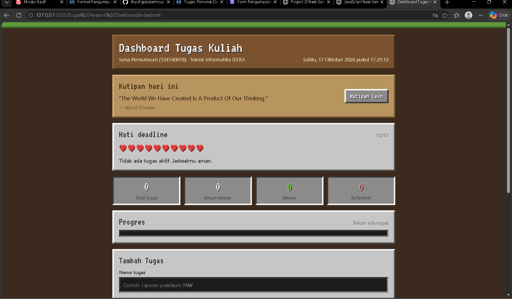

#### 2. Daftar Tugas

Menampilkan daftar tugas yang tersedia dalam aplikasi.

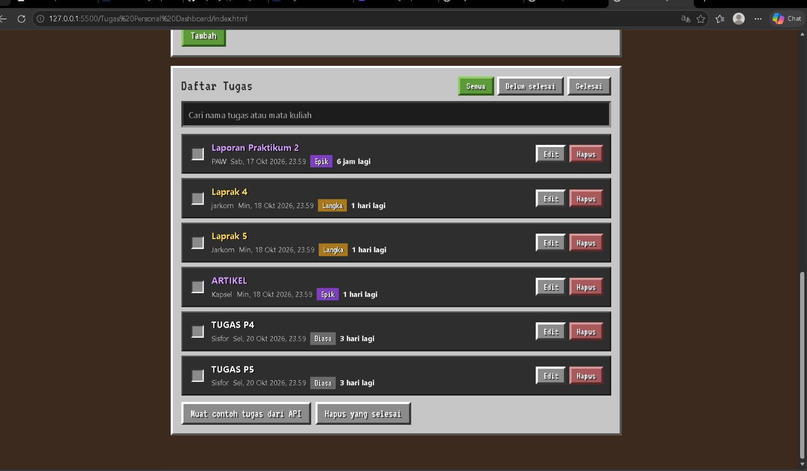

#### 3. Form Tugas

Menampilkan form untuk memasukkan data tugas.

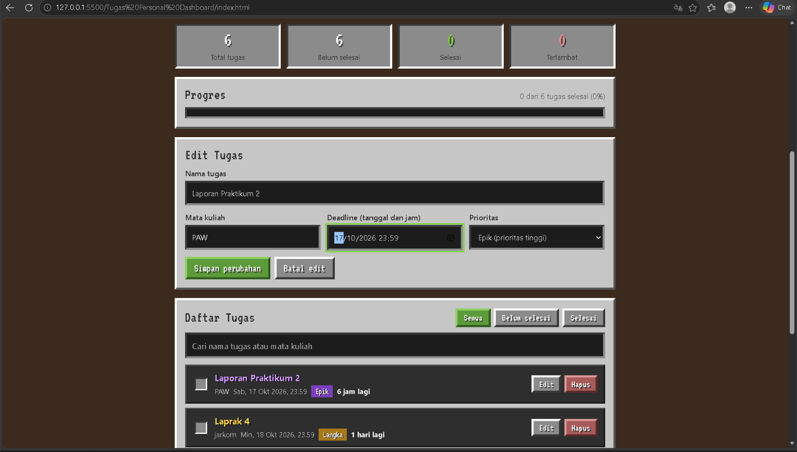

#### 4. Indikator Hati Berkurang

Menampilkan perubahan jumlah hati pada aplikasi.

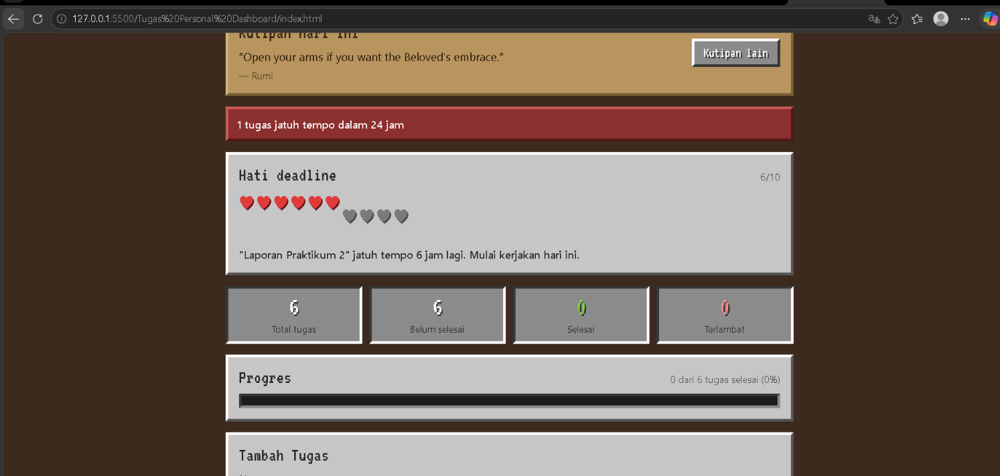

#### 5. Tampilan Mobile

Menampilkan tampilan aplikasi pada ukuran layar mobile.

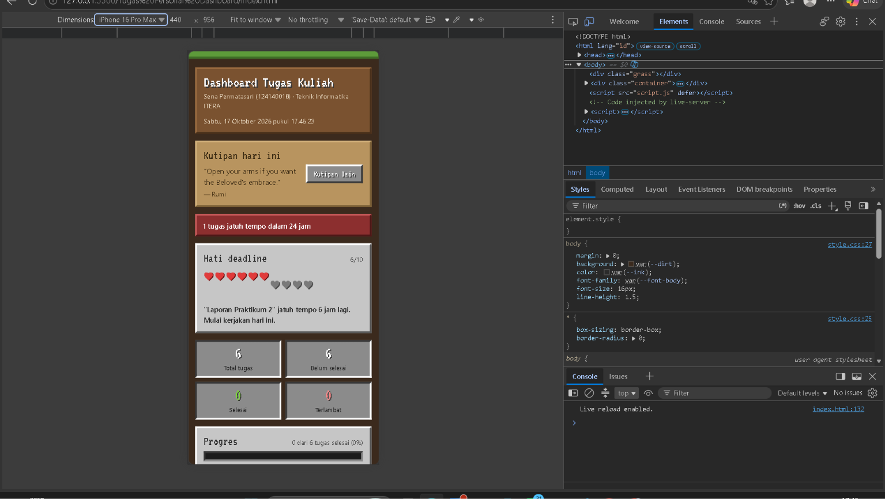

**[Lihat Hasil Pertemuan 2](senapermatasari_124140018_pertemuan2/)**

---

## Pertemuan 3 — React Basics

### Deskripsi

Pertemuan ketiga membahas pengembangan aplikasi web menggunakan React dan Vite, mulai dari pembuatan komponen, pengelolaan state, routing, Context API, hingga unit testing.

Pada pertemuan ini terdapat dua project, yaitu **My React App** sebagai hasil praktikum dan **BookNest** sebagai tugas.

### 1. My React App — Praktikum

My React App merupakan project yang dibuat untuk mengimplementasikan konsep-konsep dasar React sesuai materi praktikum.

**Materi yang Diimplementasikan:**

- Setup React menggunakan Vite
- Components dan Props
- State Management dan React Hooks
- Routing menggunakan React Router
- Custom Hooks
- Context API
- Unit Testing

**[Lihat My React App](Sena_Permatasari_124140018_pertemuan3/my-react-app/)**

### 2. BookNest — Tugas

BookNest merupakan aplikasi manajemen koleksi buku pribadi yang dibuat menggunakan React dan Vite.

Aplikasi ini memungkinkan pengguna mengelola daftar buku, melakukan pencarian, memfilter koleksi, dan melihat statistik buku.

**Fitur BookNest:**

- Menambahkan buku baru
- Mengedit informasi buku
- Menghapus buku
- Mencari buku berdasarkan judul atau penulis
- Memfilter buku berdasarkan status
- Menampilkan statistik koleksi buku
- Menyimpan data menggunakan localStorage
- Navigasi antarhalaman menggunakan React Router
- Pengelolaan state dengan Context API
- Unit Testing menggunakan Vitest

### Dokumentasi BookNest

#### 1. Halaman Home

Menampilkan halaman utama aplikasi BookNest.

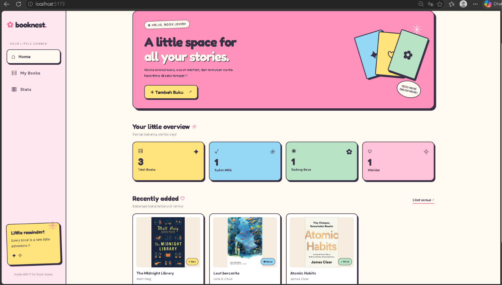

#### 2. Halaman My Books

Menampilkan koleksi buku yang tersimpan dalam aplikasi.

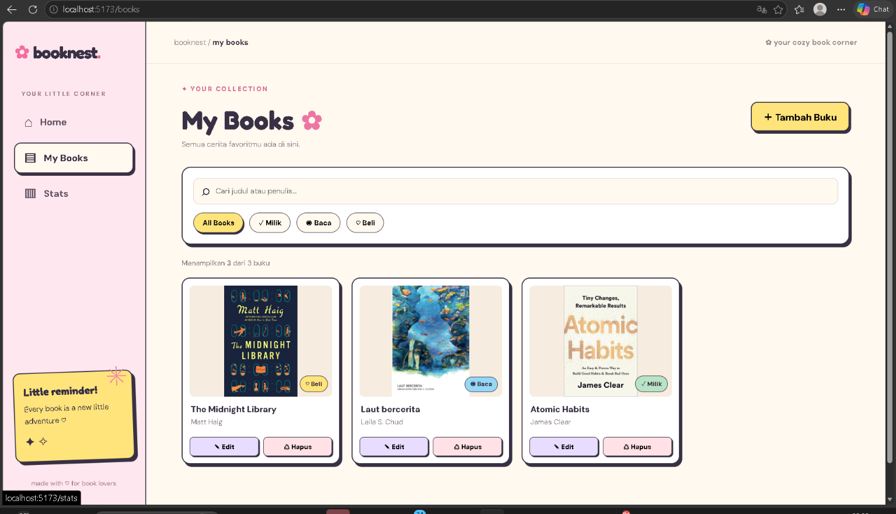

#### 3. Form Tambah Buku

Menampilkan form untuk menambahkan data buku baru.

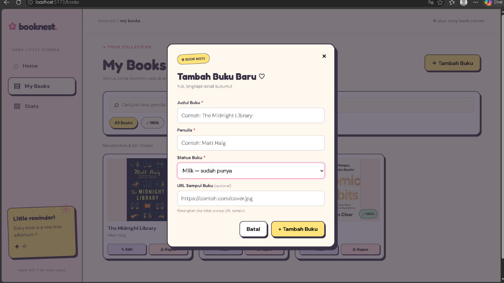

#### 4. Halaman Statistik

Menampilkan ringkasan dan statistik koleksi buku.

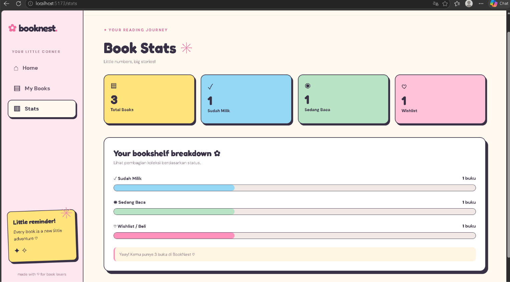

#### 5. Hasil Unit Testing

Pengujian BookNest menggunakan Vitest dengan hasil 10 tests passed.

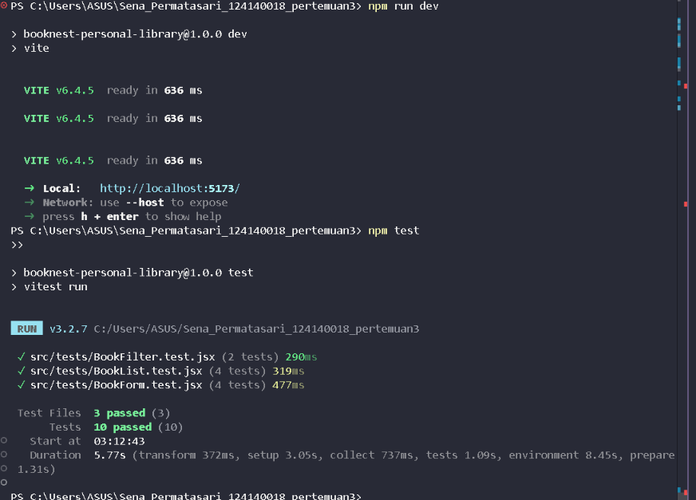

**[Lihat Project BookNest](Sena_Permatasari_124140018_pertemuan3/BookNest/)**

---

## Pertemuan 4 — Python Dasar

### Deskripsi

Pertemuan keempat membahas dasar-dasar pemrograman Python, mulai dari pengenalan sintaks, variabel, tipe data, struktur kendali, fungsi, hingga modularitas menggunakan modul dan package.

### Materi yang Dipelajari

- Pengenalan dan eksekusi Python
- Variabel dan tipe data
- Struktur kendali
- Modularitas dan fungsi
- Struktur data
- Modul dan package Python

### Hasil Praktikum

Pada pertemuan ini dibuat beberapa program untuk menerapkan materi Python, yaitu program perhitungan BMI, pengolahan nilai mahasiswa, serta penggunaan modul operasi matematika.

### Dokumentasi Pertemuan 4

#### 1. Pengujian Program BMI dengan Kategori Normal

Menampilkan hasil perhitungan BMI dengan kategori normal.

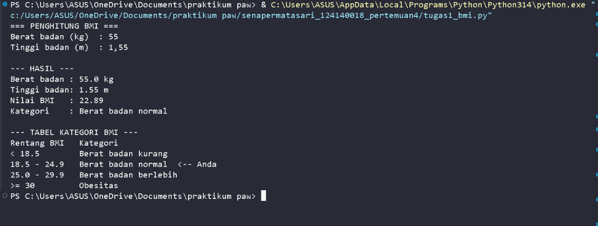

#### 2. Pengujian Program BMI dengan Kategori Berat Berlebih

Menampilkan hasil perhitungan BMI dengan kategori berat berlebih.

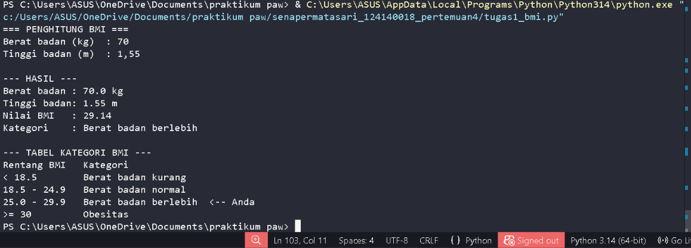

#### 3. Validasi Input Program BMI

Menampilkan validasi terhadap input yang tidak sesuai.

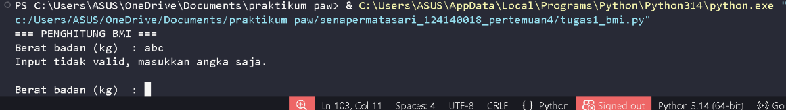

#### 4. Pengujian Program BMI dengan Kategori Berat Badan Kurang

Menampilkan hasil perhitungan BMI dengan kategori berat badan kurang.

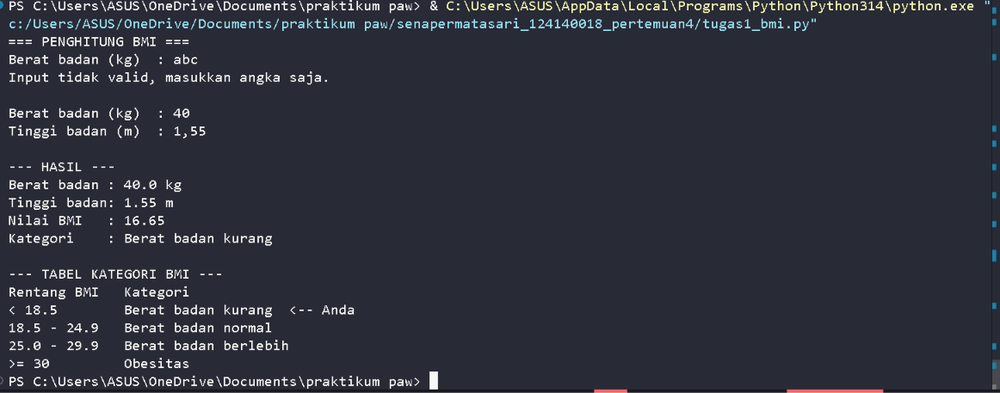

#### 5. Pengujian Program BMI dengan Kategori Obesitas

Menampilkan hasil perhitungan BMI dengan kategori obesitas.

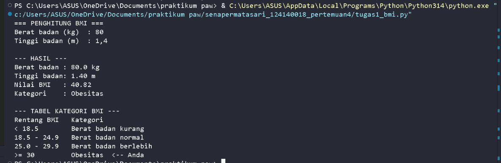

#### 6. Hasil Pengolahan Data dan Tabel Nilai Mahasiswa

Menampilkan hasil pengolahan data nilai mahasiswa dalam bentuk tabel.

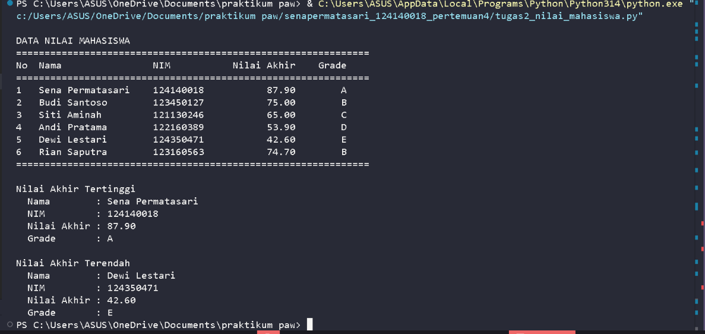

#### 7. Implementasi Modul pada Program Utama

Menampilkan penggunaan fungsi dari modul `math_operations.py` melalui `main.py`.

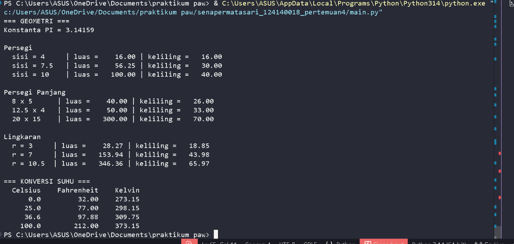

#### 8. Pemeriksaan Kode Menggunakan Pycodestyle

Menampilkan hasil pemeriksaan kode berdasarkan standar PEP 8.

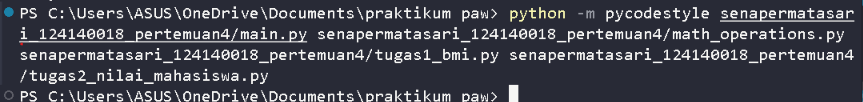

#### 9. Pengujian Modul Secara Langsung

Menampilkan pengujian fungsi pada modul `math_operations.py` secara langsung.

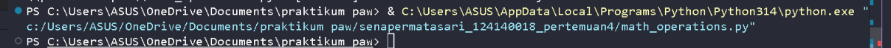

**[Lihat Hasil Pertemuan 4](senapermatasari_124140018_pertemuan4/)**

---

## Pertemuan 5 — Python OOP

### Deskripsi

Pertemuan kelima membahas Pemrograman Berorientasi Objek (Object-Oriented Programming) pada Python, mulai dari konsep objek dan class, pewarisan, enkapsulasi, polimorfisme, hingga abstract class. Materi diterapkan dalam latihan terbimbing, latihan mandiri, dan tugas berupa sistem manajemen perpustakaan.

### Materi yang Dipelajari

- Everything is Object pada Python
- Pemrograman prosedural vs OOP
- Class dan Object
- Inheritance (pewarisan)
- Encapsulation (enkapsulasi)
- Polymorphism
- Abstract Class

### Struktur Folder

| Folder | Isi |
|---|---|
| `latihan/` | 7 file latihan terbimbing sesuai materi (objek, prosedural vs OOP, class, inheritance, encapsulation, polymorphism, abstract class) |
| `latihan_mandiri/` | 6 file latihan mandiri (toko online, kartu buku, armada truk, gaji karyawan, siaran notifikasi, layanan penyimpanan) |
| `tugas_perpustakaan/` | Tugas utama: program manajemen perpustakaan (`library_item.py`, `member.py`, `library.py`, `main.py`) |
| `ss/` | Screenshot hasil menjalankan program |

### Hasil Praktikum

Pada latihan terbimbing dan latihan mandiri dibuat berbagai program kecil untuk mempraktikkan setiap konsep OOP. Pada bagian tugas dibuat program manajemen perpustakaan berbasis menu yang memiliki class terpisah untuk item perpustakaan, anggota, dan pengelolaan perpustakaan.

**Fitur Program Perpustakaan:**

- Menampilkan katalog item perpustakaan
- Menampilkan item yang tersedia
- Menambahkan item baru
- Mencari item
- Meminjam dan mengembalikan item
- Penerapan enkapsulasi pada data item

### Dokumentasi Pertemuan 5

#### 1. Menu Katalog dan Item Tersedia

Menampilkan menu program untuk melihat katalog dan item yang tersedia.

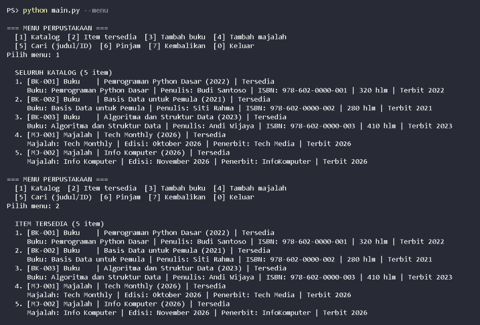

#### 2. Menu Tambah Item

Menampilkan menu untuk menambahkan item baru ke perpustakaan.

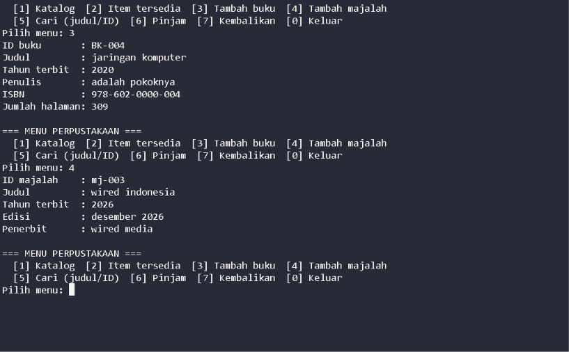

#### 3. Menu Cari, Pinjam, dan Kembali

Menampilkan menu pencarian serta proses peminjaman dan pengembalian item.

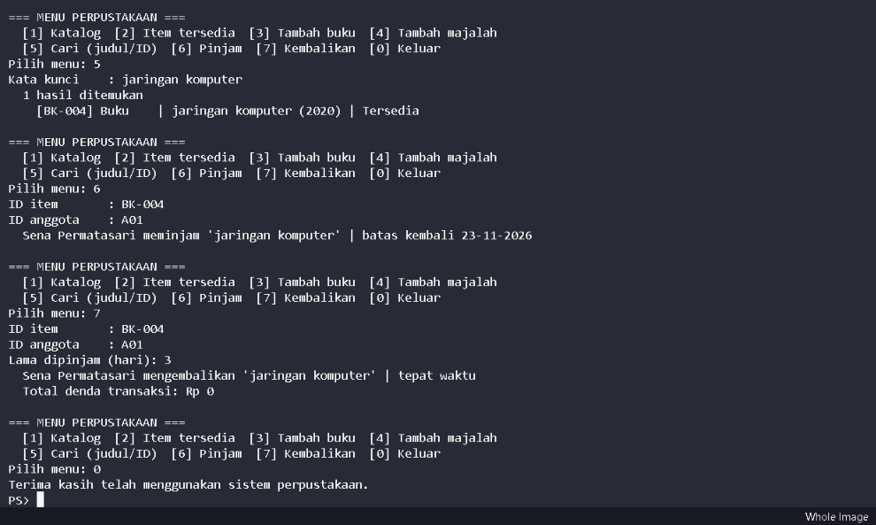

#### 4. Katalog Perpustakaan

Menampilkan hasil katalog item perpustakaan.

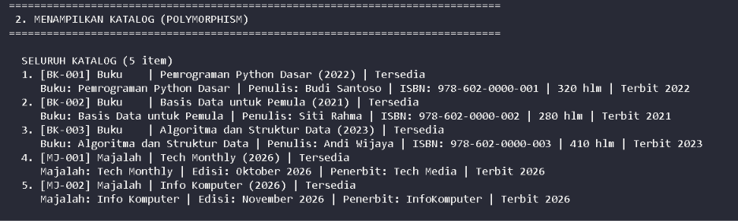

#### 5. Menambah Item

Menampilkan hasil penambahan item pada perpustakaan.

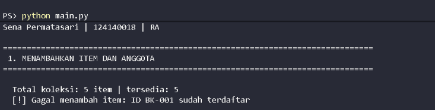

#### 6. Pencarian Item

Menampilkan hasil pencarian item pada perpustakaan.

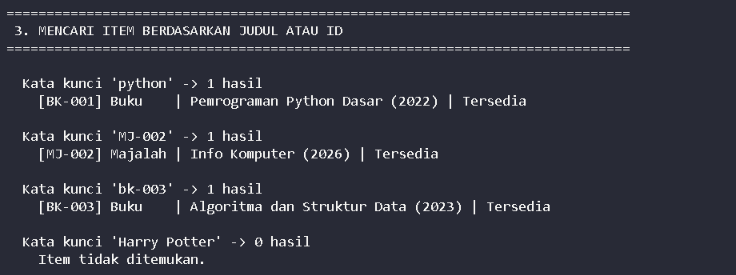

#### 7. Peminjaman Item

Menampilkan hasil proses peminjaman item.

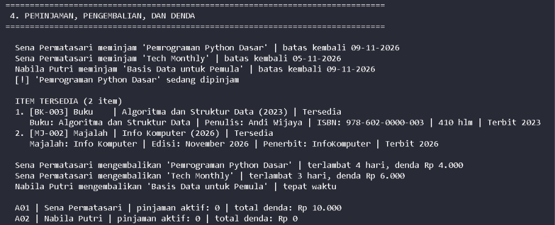

#### 8. Pengujian Enkapsulasi

Menampilkan penerapan enkapsulasi pada data program.

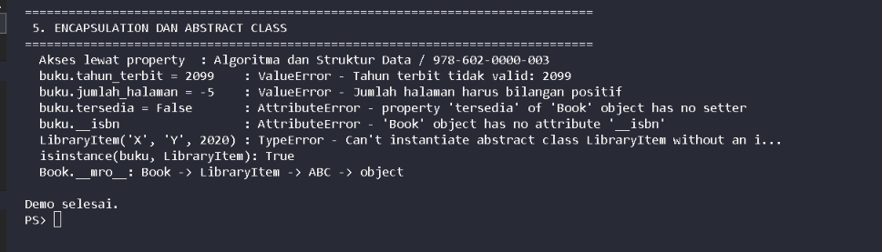

**[Lihat Hasil Pertemuan 5](senapermatasari_124140018_pertemuan5/)**

---

## Pertemuan 6 — Pyramid dan PostgreSQL

### Deskripsi

Pertemuan keenam membahas pengembangan aplikasi web menggunakan Pyramid Framework dengan PostgreSQL sebagai sistem manajemen basis data. Praktikum ini menerapkan SQLAlchemy sebagai ORM dan Alembic untuk mengelola migrasi database.

### Materi yang Dipelajari

- Pengenalan Pyramid Framework
- Konfigurasi koneksi PostgreSQL
- Penggunaan SQLAlchemy ORM
- Pembuatan Model dan Database Migration
- Implementasi REST API
- Operasi CRUD (Create, Read, Update, Delete)

### Hasil Praktikum

Pada pertemuan ini dibuat aplikasi pengelolaan data mahasiswa dan mata kuliah menggunakan Pyramid dan PostgreSQL.

**Fitur CRUD Mahasiswa:**

- Menampilkan seluruh data mahasiswa
- Melihat detail mahasiswa berdasarkan ID
- Menambahkan data mahasiswa
- Memperbarui data mahasiswa
- Menghapus data mahasiswa

**Fitur CRUD Matakuliah:**

- Menampilkan seluruh data mata kuliah
- Melihat detail mata kuliah berdasarkan ID
- Menambahkan data mata kuliah
- Memperbarui data mata kuliah
- Menghapus data mata kuliah

### Endpoint API

**Mahasiswa**

| Method | Endpoint | Keterangan |
|---|---|---|
| GET | `/api/mahasiswa` | Menampilkan seluruh data mahasiswa |
| GET | `/api/mahasiswa/{id}` | Menampilkan detail mahasiswa |
| POST | `/api/mahasiswa` | Menambahkan mahasiswa |
| PUT | `/api/mahasiswa/{id}` | Memperbarui data mahasiswa |
| DELETE | `/api/mahasiswa/{id}` | Menghapus mahasiswa |

**Matakuliah**

| Method | Endpoint | Keterangan |
|---|---|---|
| GET | `/api/matakuliah` | Menampilkan seluruh data mata kuliah |
| GET | `/api/matakuliah/{id}` | Menampilkan detail mata kuliah |
| POST | `/api/matakuliah` | Menambahkan mata kuliah |
| PUT | `/api/matakuliah/{id}` | Memperbarui data mata kuliah |
| DELETE | `/api/matakuliah/{id}` | Menghapus mata kuliah |

### Dokumentasi Pertemuan 6

#### 1. Struktur Project

Menampilkan struktur folder dan file project Pyramid.

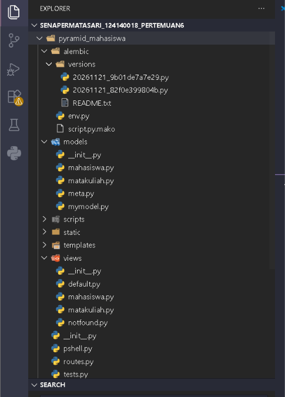

#### 2. Model Mahasiswa

Menampilkan implementasi model Mahasiswa menggunakan SQLAlchemy.

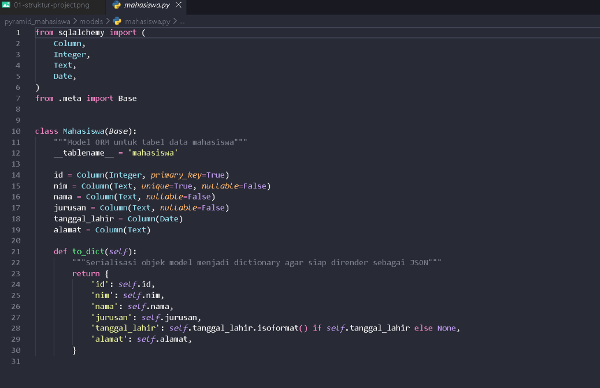

#### 3. Model Matakuliah

Menampilkan implementasi model Matakuliah menggunakan SQLAlchemy.

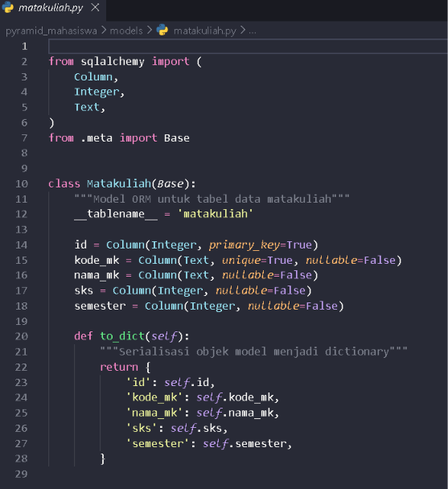

#### 4. Migration Mahasiswa

Menampilkan proses migrasi tabel Mahasiswa menggunakan Alembic.

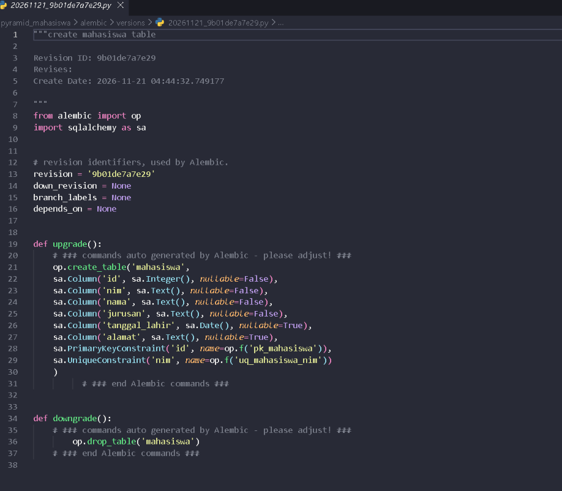

#### 5. Migration Matakuliah

Menampilkan proses migrasi tabel Matakuliah menggunakan Alembic.

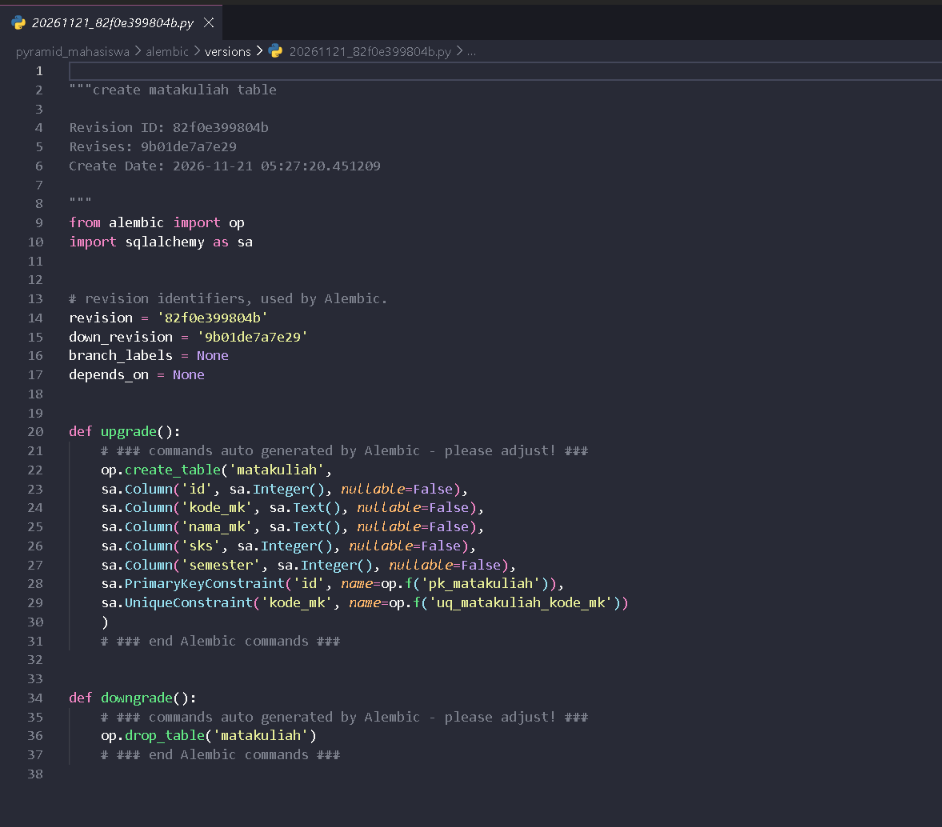

#### 6. CRUD Mahasiswa

Menampilkan proses Create dan Read data mahasiswa.

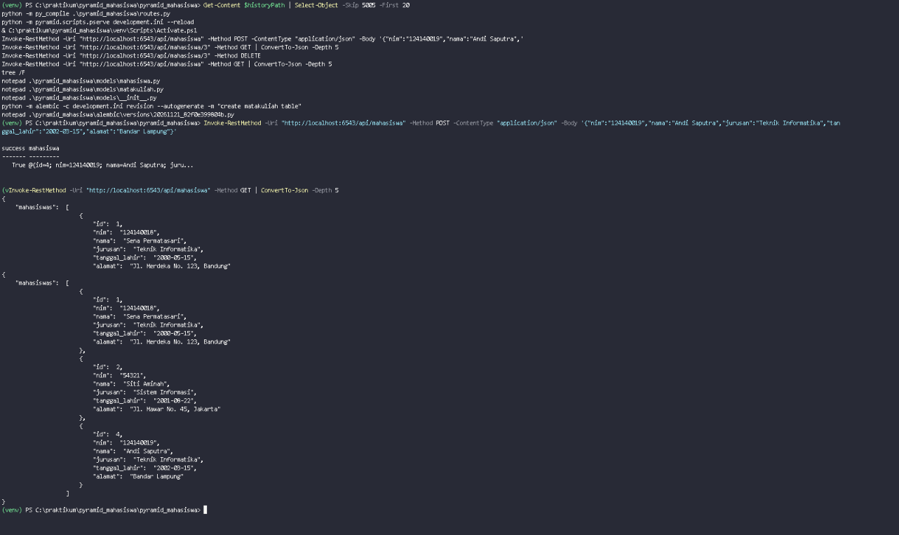

Menampilkan proses Update dan Delete data mahasiswa.

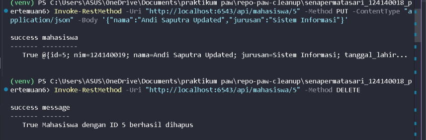

#### 7. CRUD Matakuliah

Menampilkan proses Create dan Read data mata kuliah.

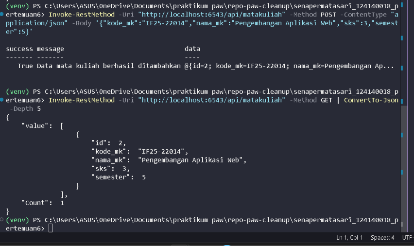

Menampilkan proses Update dan Delete data mata kuliah.

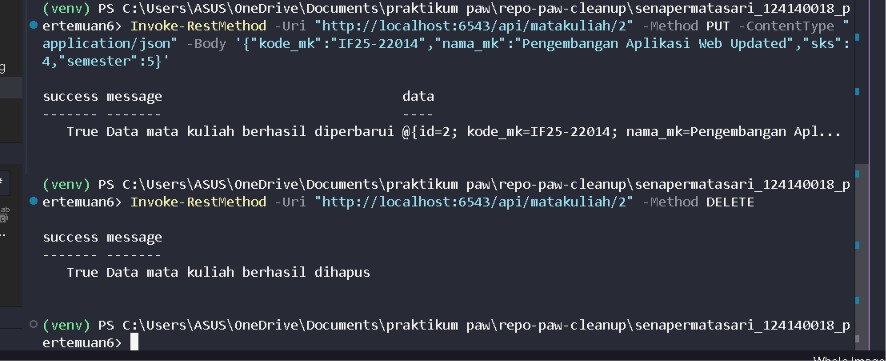

**[Lihat Hasil Pertemuan 6](senapermatasari_124140018_pertemuan6/)**

---

## Teknologi yang Digunakan

| Teknologi | Kegunaan |
|---|---|
| HTML | Struktur halaman web |
| CSS | Tampilan dan desain aplikasi |
| JavaScript | Logika dan interaksi aplikasi |
| React | Pengembangan antarmuka berbasis komponen |
| Vite | Development server dan build tool |
| React Router | Navigasi antarhalaman |
| Context API | Pengelolaan state global |
| localStorage | Penyimpanan data pada browser |
| Vitest | Pengujian aplikasi React |
| Python | Bahasa pemrograman untuk praktikum dasar dan OOP |
| Pyramid | Framework pengembangan aplikasi web Python |
| SQLAlchemy | ORM untuk mengelola interaksi dengan database |
| PostgreSQL | Sistem manajemen basis data relasional |
| Alembic | Pengelolaan migrasi database |

---

## Cara Menjalankan Project

### 1. Clone Repository

```bash
git clone https://github.com/sena0616/pemograman_web_itera_124140018.git
```

### 2. Pertemuan 1 dan 2

1. Buka folder pertemuan yang ingin dijalankan.
2. Buka file `index.html` menggunakan browser.
3. Aplikasi dapat digunakan sesuai fitur yang tersedia.

### 3. Pertemuan 3 — My React App

Masuk ke folder project:

```bash
cd Sena_Permatasari_124140018_pertemuan3/my-react-app
```

Install dependencies:

```bash
npm install
```

Jalankan development server:

```bash
npm run dev
```

### 4. Pertemuan 3 — BookNest

Masuk ke folder project:

```bash
cd Sena_Permatasari_124140018_pertemuan3/BookNest
```

Install dependencies:

```bash
npm install
```

Jalankan development server:

```bash
npm run dev
```

Buka alamat localhost yang ditampilkan pada terminal.

### 5. Menjalankan Unit Testing BookNest

Dari folder BookNest, jalankan:

```bash
npm test
```

### 6. Pertemuan 4 — Python Dasar

Pastikan Python sudah terpasang. Masuk ke folder Pertemuan 4, kemudian jalankan program yang ingin diuji.

Contoh menjalankan program BMI:

```bash
python tugas1_bmi.py
```

Menjalankan program pengolahan nilai mahasiswa:

```bash
python tugas2_nilai_mahasiswa.py
```

Menjalankan program utama:

```bash
python main.py
```

### 7. Pertemuan 5 — Python OOP

Pastikan Python sudah terpasang. Masuk ke folder Pertemuan 5:

```bash
cd senapermatasari_124140018_pertemuan5
```

Menjalankan salah satu file latihan, contohnya:

```bash
python latihan/03_inheritance.py
```

Menjalankan salah satu latihan mandiri, contohnya:

```bash
python latihan_mandiri/lat1_toko_online.py
```

Menjalankan program tugas perpustakaan:

```bash
cd tugas_perpustakaan
python main.py
```

### 8. Pertemuan 6 — Pyramid dan PostgreSQL

Pastikan Python dan PostgreSQL sudah terpasang. Buat dan aktifkan virtual environment, lalu masuk ke folder project Pertemuan 6.

Install dependencies sesuai konfigurasi project:

```bash
python -m pip install -e .
```

Konfigurasikan koneksi database PostgreSQL pada `development.ini`, kemudian jalankan migrasi database:

```bash
python -m alembic -c development.ini upgrade head
```

Jalankan aplikasi Pyramid:

```bash
python -m pyramid.scripts.pserve development.ini --reload
```

Buka aplikasi melalui browser pada:

```text
http://localhost:6543
```

---

## Kesimpulan

Melalui rangkaian praktikum ini, dipelajari dasar pengembangan web menggunakan JavaScript hingga penerapan framework React untuk membangun aplikasi yang lebih interaktif dan terstruktur. Selain itu, dipelajari pula dasar pemrograman Python, konsep pemrograman berorientasi objek, serta pengembangan aplikasi web menggunakan Pyramid Framework yang terintegrasi dengan PostgreSQL.

Praktikum memberikan pengalaman dalam mengelola komponen, state, navigasi, penyimpanan data, modularitas program, perancangan class, pengelolaan database, implementasi REST API, serta pengujian aplikasi.

---

**Sena Permatasari — 124140018**  
**Teknik Informatika — Institut Teknologi Sumatera**
