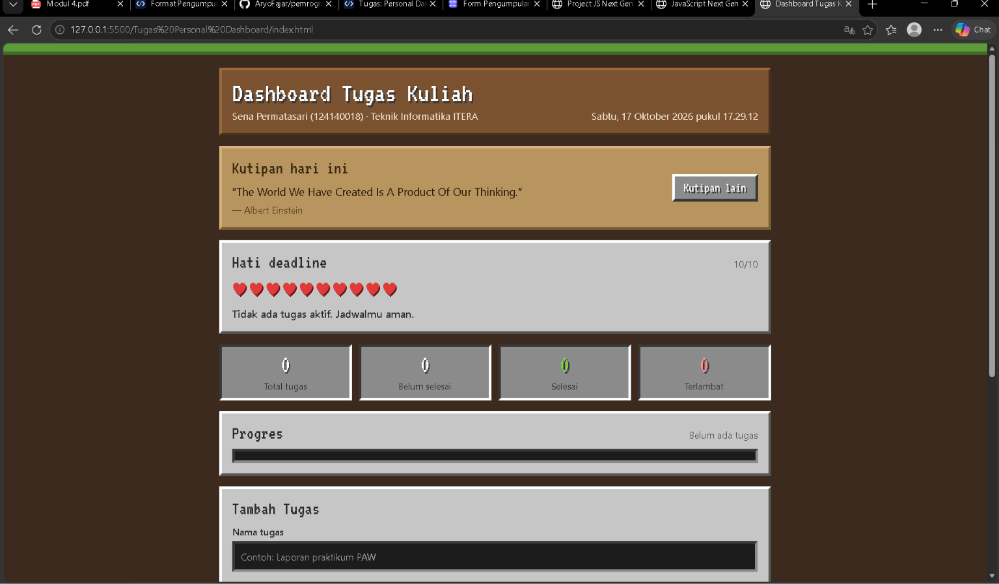

# Dashboard Tugas Kuliah (Tema Minecraft)

**Nama:** Sena Permatasari
**NIM:** 124140018
**Program Studi:** Teknik Informatika, ITERA
**Tugas:** Praktikum PAW Pertemuan 2, JavaScript Next Gen (ES6+)

## Deskripsi Aplikasi

Dashboard Tugas Kuliah adalah aplikasi pencatat tugas untuk mahasiswa dengan tampilan bergaya Minecraft. Aplikasi ini membantu memantau deadline tugas, dilengkapi indikator hati yang berkurang saat deadline makin dekat.

## Fitur

- **Tambah, edit, hapus tugas** (nama, mata kuliah, deadline tanggal dan jam, prioritas).
- **Penyimpanan lokal:** data tersimpan di `localStorage`, tetap ada setelah halaman di-refresh.
- **Hati deadline:** 10 hati yang mengikuti tugas belum selesai dengan deadline paling dekat. Makin mepet, makin sedikit hati. Tugas terlambat membuat hati menjadi 0.
- **Pesan tugas terdekat:** teks di bawah hati menjelaskan tugas mana yang paling mendesak.
- **Tingkat kelangkaan:** prioritas rendah, sedang, dan tinggi tampil sebagai Biasa (putih), Langka (kuning), dan Epik (ungu).
- **Jam live** di header dan penyegaran sisa waktu otomatis tiap menit.
- **Statistik dan progres:** total, belum selesai, selesai, terlambat, serta bar progres.
- **Cari dan filter** daftar tugas.
- **Kutipan harian** dari API publik DummyJSON (async/await).
- **Contoh tugas dari API** JSONPlaceholder (tombol opsional).
- **Tampilan responsif** untuk layar HP.

## Aturan Hati Deadline

| Sisa waktu tugas terdekat | Hati |
|---|---|
| Tidak ada tugas aktif, atau lebih dari 3 hari | 10 |
| 24 jam sampai 3 hari | 8 |
| 6 sampai 24 jam | 6 |
| 1 sampai 6 jam | 3 |
| 1 jam atau kurang | 1 |
| Terlambat | 0 |

## Screenshot

**Tampilan utama**



**Daftar tugas dengan tingkat kelangkaan**


**Form tambah dan edit tugas**


**Hati aman (deadline masih jauh)**


**Hati berkurang (deadline mepet)**


**Tampilan mobile**


## Daftar Fitur ES6+ (file `Tugas Personal Dashboard/script.js`)

| Fitur ES6+ | Baris | Keterangan |
|---|---|---|
| `const` | 5, 7, 13-17, 24, 138 | Semua variabel tidak diubah nilainya, jadi memakai `const`. `let` tidak diperlukan di file ini. Contoh `let` ada di `Modul/project-js-nextgen/js/` |
| Arrow function | 20, 24, 30, 33, 40, 43, 46, 53, 63, 74, 138, 160 | Fungsi bantu seperti `escapeHtml`, `todayStart`, `addDays`, `formatDurasi`, `heartsFor`, `pesanTerdekat` |
| Arrow function sebagai callback | 202, 207, 212, 218, 224, 241, 251, 342-344, 350-351, 371, 445 | Dipakai pada `map`, `filter`, `reduce`, `sort`, `forEach`, dan event listener |
| Template literals | 31, 40, 47, 115-117, 311-313, 358-362, 372, 407-425 | Render HTML tugas, statistik, kutipan, hati, dan label sisa waktu |
| Destructuring parameter | 74, 87-94, 342-343, 404 | Parameter `pesanTerdekat`, constructor `TaskItem`, callback `filter`, dan `renderTask` |
| Destructuring objek | 114, 226, 254-255, 283, 310, 326, 340 | Mengambil nilai dari form, dataset, respons API, dan state |
| Spread operator | 122, 197, 328 | Update tugas dan array state secara immutable |
| Default parameter | 40, 88-93 | `defaultDeadline(n = 1)` dan nilai default constructor |
| Class | 86, 131 | `TaskItem` (model data) dan `DashboardApp` (state, localStorage, fetch, render) |
| Getter | 104, 108, 112, 339, 348 | `msLeft`, `isOverdue`, `dueLabel`, `visibleTasks`, `nearestTask` |
| Async/await | 305-317, 319-336 | `loadQuote()` dan `importSample()` dengan `fetch`, `try/catch/finally` |
| `localStorage` | 172-180, 182-188 | `load()` memakai `getItem`, `save()` memakai `setItem` |
| Array methods (`map`, `filter`, `find`, `reduce`, `sort`) | 202, 207, 212, 218, 280, 342-344, 350-351 | CRUD, pencarian, filter, dan penentuan tugas terdekat |
| `Array.from` | 371 | Membuat deret 10 hati |
| `Object.fromEntries` | 226 | Mengubah `FormData` menjadi objek |

## Sumber API Publik

- Kutipan harian: https://dummyjson.com/quotes/random
- Contoh tugas: https://jsonplaceholder.typicode.com/todos?_limit=5

## Cara Menjalankan

1. Buka folder repo di VS Code.
2. Buka folder `Tugas Personal Dashboard`, klik kanan `index.html`, pilih **Open with Live Server**.
3. Pastikan terhubung ke internet agar kutipan harian dan font piksel termuat.

## Struktur Folder

```
senapermatasari_124140018_pertemuan2/
├── README.md
├── SS/                         (screenshot)
├── Tugas Personal Dashboard/
│   ├── index.html
│   ├── script.js
│   └── style.css
└── Modul/
    └── project-js-nextgen/     (latihan modul)
```