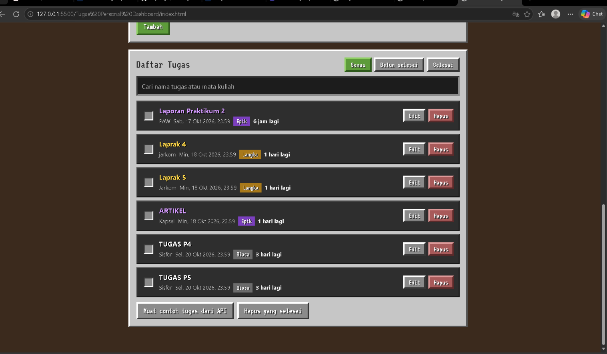
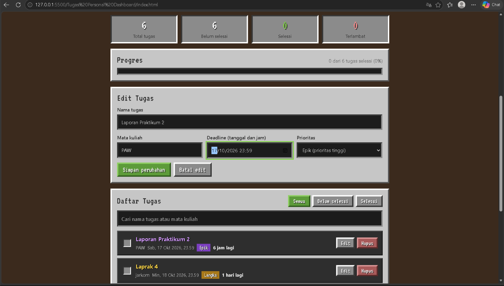
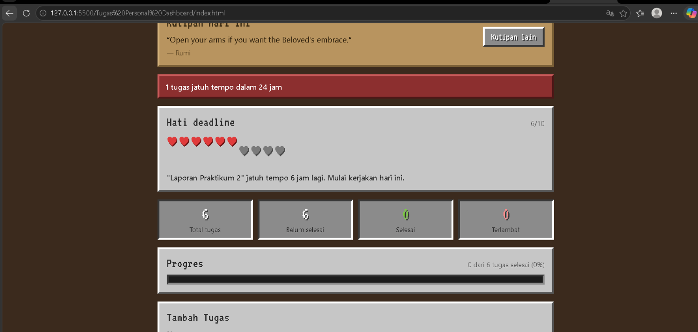
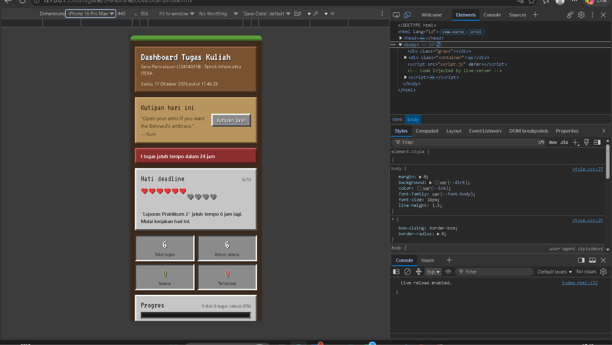

# Tugas Pemrograman Web

**Nama:** Sena Permatasari  
**NIM:** 124140018  
**Program Studi:** Teknik Informatika  
**Institusi:** Institut Teknologi Sumatera (ITERA)

## Deskripsi Repository

Repository ini berisi kumpulan hasil praktikum dan tugas mata kuliah Pemrograman Web. Materi yang dikerjakan mencakup JavaScript Dasar, JavaScript Next Gen (ES6+), serta pengembangan aplikasi berbasis React menggunakan Vite.

## Daftar Pertemuan

| No | Materi | Folder |
|---|---|---|
| 01 | JavaScript Dasar | [Pertemuan 1](senapermatasari_124140018_pertemuan1) |
| 02 | JavaScript Next Gen (ES6+) | [Pertemuan 2](senapermatasari_124140018_pertemuan2) |
| 03 | React Basics | [Pertemuan 3](Sena_Permatasari_124140018_pertemuan3) |

---

## Pertemuan 1 — JavaScript Dasar

### Deskripsi

Pertemuan pertama membahas konsep dasar JavaScript sebagai bahasa pemrograman untuk membangun interaksi dan logika pada halaman web.

### Materi yang Dipelajari

- Variabel dan tipe data
- Operator JavaScript
- Percabangan dan perulangan
- Function
- Array dan Object
- Dasar manipulasi DOM
- Event handling

### Hasil Praktikum

Pada pertemuan ini dilakukan latihan penggunaan sintaks dasar JavaScript untuk memahami cara mengolah data, menerapkan logika pemrograman, serta menambahkan interaksi pada halaman web.

**[Lihat Hasil Pertemuan 1](senapermatasari_124140018_pertemuan1)**

---

## Pertemuan 2 — JavaScript Next Gen (ES6+)

### Deskripsi

Pertemuan kedua membahas penerapan fitur modern JavaScript ES6+ dalam pengembangan aplikasi web. Fitur tersebut digunakan untuk membuat kode lebih terstruktur, mudah dibaca, dan efisien.

### Materi yang Dipelajari

- Penggunaan `let` dan `const`
- Arrow Function
- Template Literals
- Destructuring
- Spread dan Rest Operator
- Array Methods
- Modules
- Promise dan Async/Await

### Hasil Tugas

Pada pertemuan ini dibuat aplikasi pengelolaan tugas dengan tampilan dashboard, daftar tugas, form penambahan tugas, indikator hati, serta desain responsif untuk perangkat mobile.

### Dokumentasi Pertemuan 2

#### 1. Halaman Dashboard

Menampilkan halaman utama aplikasi pengelolaan tugas.


#### 2. Daftar Tugas

Menampilkan daftar tugas yang tersedia dalam aplikasi.



#### 3. Form Tugas

Menampilkan form untuk memasukkan data tugas.



#### 4. Indikator Hati Berkurang

Menampilkan perubahan jumlah hati pada aplikasi.



#### 5. Tampilan Mobile

Menampilkan tampilan aplikasi pada ukuran layar mobile.



**[Lihat Hasil Pertemuan 2](senapermatasari_124140018_pertemuan2)**

---

## Pertemuan 3 — React Basics

### Deskripsi

Pertemuan ketiga membahas pengembangan aplikasi web menggunakan React dan Vite, mulai dari pembuatan komponen, pengelolaan state, routing, Context API, hingga unit testing.

Pada pertemuan ini terdapat dua project, yaitu **My React App** sebagai hasil praktikum dan **BookNest** sebagai tugas.

### 1. My React App — Praktikum

My React App merupakan project yang dibuat untuk mengimplementasikan konsep-konsep dasar React sesuai materi praktikum.

**Materi yang Diimplementasikan:**

- Setup React menggunakan Vite
- Components dan Props
- State Management dan React Hooks
- Routing menggunakan React Router
- Custom Hooks
- Context API
- Unit Testing

**[Lihat My React App](Sena_Permatasari_124140018_pertemuan3/my-react-app)**

### 2. BookNest — Tugas

BookNest merupakan aplikasi manajemen koleksi buku pribadi yang dibuat menggunakan React dan Vite.

Aplikasi ini memungkinkan pengguna mengelola daftar buku, melakukan pencarian, memfilter koleksi, dan melihat statistik buku.

**Fitur BookNest:**

- Menambahkan buku baru
- Mengedit informasi buku
- Menghapus buku
- Mencari buku berdasarkan judul atau penulis
- Memfilter buku berdasarkan status
- Menampilkan statistik koleksi buku
- Menyimpan data menggunakan localStorage
- Navigasi antarhalaman menggunakan React Router
- Pengelolaan state dengan Context API
- Unit Testing menggunakan Vitest

### Dokumentasi BookNest

#### 1. Halaman Home

Menampilkan halaman utama aplikasi BookNest.


#### 2. Halaman My Books

Menampilkan koleksi buku yang tersimpan dalam aplikasi.


#### 3. Form Tambah Buku

Menampilkan form untuk menambahkan data buku baru.


#### 4. Halaman Statistik

Menampilkan ringkasan dan statistik koleksi buku.


#### 5. Hasil Unit Testing

Pengujian BookNest menggunakan Vitest dengan hasil 10 tests passed.


**[Lihat Project BookNest](Sena_Permatasari_124140018_pertemuan3/BookNest)**

---

## Teknologi yang Digunakan

| Teknologi | Kegunaan |
|---|---|
| HTML | Struktur halaman web |
| CSS | Tampilan dan desain aplikasi |
| JavaScript | Logika dan interaksi aplikasi |
| React | Pengembangan antarmuka berbasis komponen |
| Vite | Development server dan build tool |
| React Router | Navigasi antarhalaman |
| Context API | Pengelolaan state global |
| localStorage | Penyimpanan data pada browser |
| Vitest | Pengujian aplikasi React |

## Cara Menjalankan Project

### 1. Clone Repository

```bash
git clone https://github.com/sena0616/pemograman_web_itera_124140018.git
```

### 2. Pertemuan 1 dan 2

1. Buka folder pertemuan yang ingin dijalankan.
2. Buka file `index.html` menggunakan browser.
3. Aplikasi dapat digunakan sesuai fitur yang tersedia.

### 3. Pertemuan 3 — My React App

Masuk ke folder project:

```bash
cd Sena_Permatasari_124140018_pertemuan3/my-react-app
```

Install dependencies:

```bash
npm install
```

Jalankan development server:

```bash
npm run dev
```

### 4. Pertemuan 3 — BookNest

Masuk ke folder project:

```bash
cd Sena_Permatasari_124140018_pertemuan3/BookNest
```

Install dependencies:

```bash
npm install
```

Jalankan development server:

```bash
npm run dev
```

Buka alamat localhost yang ditampilkan pada terminal.

### 5. Menjalankan Unit Testing BookNest

Dari folder BookNest, jalankan:

```bash
npm test
```

---

## Kesimpulan

Melalui rangkaian praktikum ini, dipelajari dasar pengembangan web menggunakan JavaScript hingga penerapan framework React untuk membangun aplikasi yang lebih interaktif dan terstruktur.

Praktikum juga memberikan pengalaman dalam mengelola komponen, state, navigasi, penyimpanan data, serta pengujian aplikasi.

---

**Sena Permatasari — 124140018**  
**Teknik Informatika — Institut Teknologi Sumatera**
