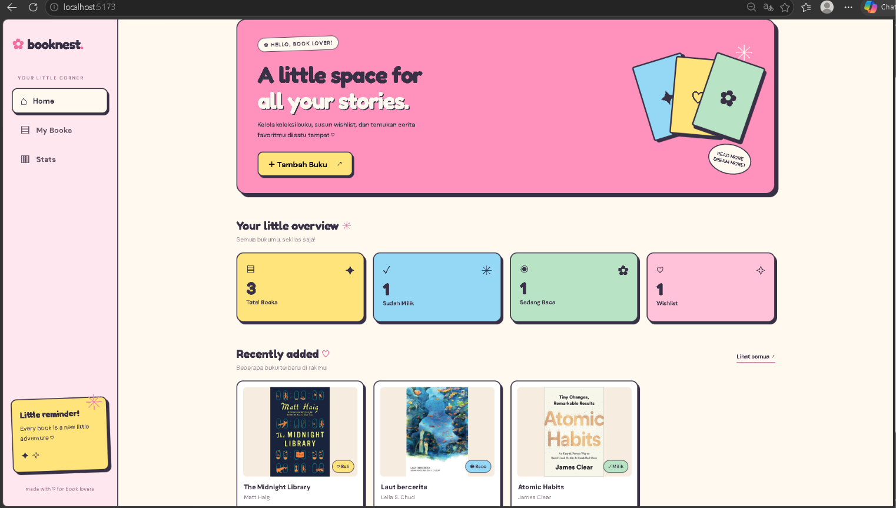
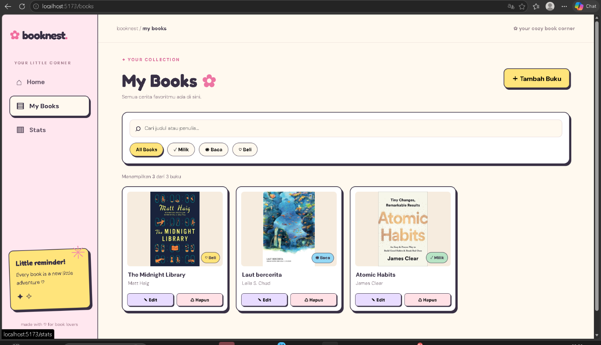
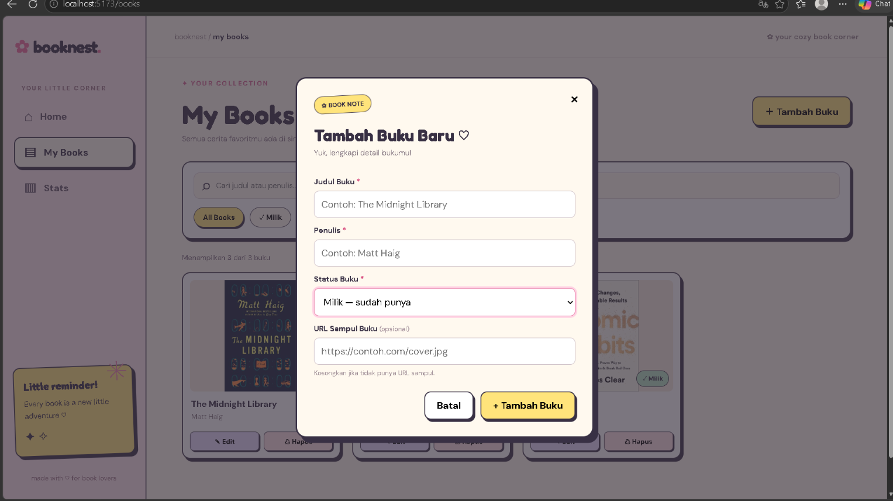
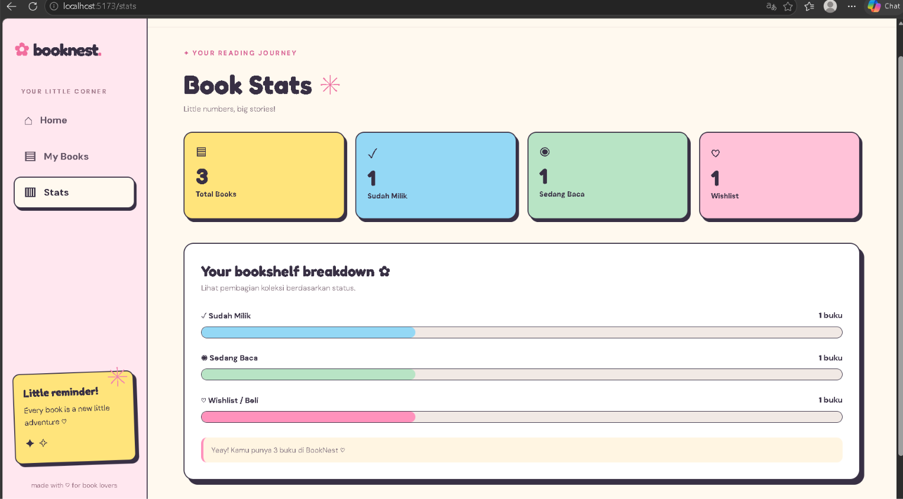
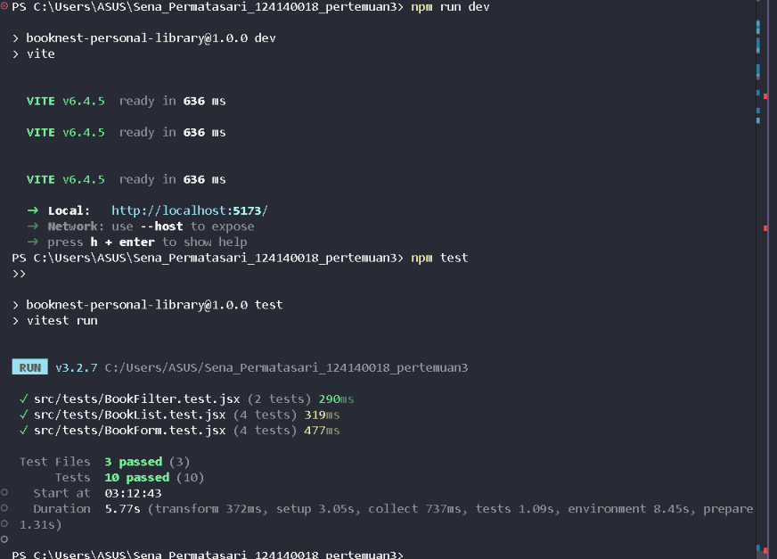

# 📚 BookNest — Personal Book Library

**Tugas Pertemuan 3 — Pemrograman Aplikasi Web**

| Identitas | Keterangan |
|---|---|
| Nama | Sena Permatasari |
| NIM | 124140018 |
| Mata Kuliah | Pemrograman Aplikasi Web |
| Framework | React + Vite |

## 📖 Tentang BookNest

BookNest adalah aplikasi web untuk mengelola koleksi buku pribadi. Pengguna dapat menambahkan buku, mengubah informasi buku, menghapus buku, mencari buku berdasarkan judul atau penulis, serta memfilter koleksi berdasarkan status buku.

BookNest memiliki tampilan bertema **Retro Scrapbook & Candy Pop** dengan perpaduan warna pink, kuning, biru pastel, dan krem.

Data buku disimpan menggunakan **localStorage**, sehingga koleksi tetap tersedia setelah halaman dimuat ulang pada browser yang sama.

## ✨ Fitur Aplikasi

- **Tambah Buku** — Menambahkan judul, penulis, status, dan URL sampul buku.
- **Edit Buku** — Mengubah informasi buku yang telah tersimpan.
- **Hapus Buku** — Menghapus buku dari koleksi.
- **Pencarian Buku** — Mencari buku berdasarkan judul atau penulis.
- **Filter Status** — Menampilkan buku berdasarkan status Milik, Baca, atau Beli.
- **Statistik Koleksi** — Melihat ringkasan jumlah buku berdasarkan status.
- **Penyimpanan Lokal** — Menyimpan data menggunakan localStorage.
- **Navigasi Halaman** — Berpindah antara Home, My Books, dan Stats.
- **Validasi Form** — Memastikan informasi wajib diisi sebelum buku disimpan.

## 🛠️ Teknologi yang Digunakan

| Teknologi | Kegunaan |
|---|---|
| React | Membangun antarmuka berbasis komponen |
| Vite | Development server dan build tool |
| JavaScript JSX | Logika aplikasi dan komponen |
| CSS | Styling dan tampilan responsif |
| React Router | Navigasi antarhalaman |
| Context API | Pengelolaan state koleksi buku |
| Custom Hooks | Logika penyimpanan dan statistik |
| localStorage | Penyimpanan data pada browser |
| PropTypes | Validasi tipe props komponen |
| Vitest | Pengujian unit |
| React Testing Library | Pengujian komponen React |

## 📁 Struktur Folder

```text
src/
├── assets/
│   ├── hero.png
│   ├── react.svg
│   └── vite.svg
├── components/
│   ├── BookCard/
│   │   └── BookCard.jsx
│   ├── BookFilter/
│   │   ├── BookFilter.css
│   │   └── BookFilter.jsx
│   ├── BookForm/
│   │   ├── BookForm.css
│   │   └── BookForm.jsx
│   ├── BookList/
│   │   ├── BookList.css
│   │   └── BookList.jsx
│   └── Sidebar/
│       └── Sidebar.jsx
├── context/
│   └── BookContext.jsx
├── hooks/
│   ├── useBookStats.js
│   └── useLocalStorage.js
├── pages/
│   ├── Home/
│   │   ├── Home.css
│   │   └── Home.jsx
│   ├── MyBooks/
│   │   └── MyBooks.jsx
│   └── Stats/
│       ├── Stats.css
│       └── Stats.jsx
├── tests/
│   ├── BookFilter.test.jsx
│   ├── BookForm.test.jsx
│   ├── BookList.test.jsx
│   └── setup.js
├── App.css
├── App.jsx
├── index.css
└── main.jsx
```

## 🚀 Cara Menjalankan Aplikasi

### 1. Clone Repository

```bash
git clone https://github.com/USERNAME/NAMA-REPOSITORY.git
cd NAMA-REPOSITORY
```

Ganti `USERNAME` dan `NAMA-REPOSITORY` sesuai repository GitHub.

### 2. Install Dependencies

```bash
npm install
```

### 3. Jalankan Development Server

```bash
npm run dev
```

Buka alamat lokal yang ditampilkan Vite pada terminal, biasanya:

http://localhost:5173/

### 4. Jalankan Unit Test

```bash
npm test
```

## 🧩 Implementasi React

Aplikasi BookNest menerapkan beberapa konsep React:

1. **Reusable Components** — BookCard, BookFilter, BookForm, BookList, dan Sidebar.
2. **React Hooks** — Menggunakan hooks untuk mengelola state dan efek pada aplikasi.
3. **Context API** — BookContext digunakan untuk mengelola data koleksi buku.
4. **Custom Hooks** — useLocalStorage untuk penyimpanan data dan useBookStats untuk statistik koleksi.
5. **React Router** — Mengatur navigasi halaman Home, My Books, dan Stats.
6. **PropTypes** — Validasi tipe props pada komponen.
7. **Unit Testing** — Pengujian komponen menggunakan Vitest dan React Testing Library.

## 📸 Dokumentasi Aplikasi

### 1. Halaman Home

Halaman utama BookNest dengan tampilan bertema Retro Scrapbook dan navigasi aplikasi.



### 2. Halaman My Books

Menampilkan daftar koleksi buku pribadi beserta informasi buku dan statusnya.



### 3. Form Tambah Buku

Form untuk menambahkan buku baru dengan informasi judul, penulis, status, dan URL sampul.



### 4. Halaman Stats

Menampilkan statistik dan ringkasan koleksi buku berdasarkan status.



## 🧪 Unit Testing

Pengujian dilakukan menggunakan **Vitest** dan **React Testing Library**.

| File Pengujian | Jumlah Test | Hasil |
|---|---:|---|
| BookFilter.test.jsx | 2 | Passed |
| BookList.test.jsx | 4 | Passed |
| BookForm.test.jsx | 4 | Passed |
| **Total** | **10** | **Passed** |

Hasil pengujian:

```text
Test Files  3 passed (3)
     Tests  10 passed (10)
  Duration  5.77s
```

Seluruh 10 unit test berhasil dijalankan tanpa kegagalan.

### Screenshot Hasil Unit Test



## 💾 Penyimpanan Data

BookNest menggunakan localStorage untuk menyimpan koleksi buku pada browser pengguna. Data dapat dipertahankan saat halaman dimuat ulang tanpa memerlukan database eksternal.

## 👩‍💻 Pengembang

**Sena Permatasari**  
**124140018**  
Institut Teknologi Sumatera (ITERA)

---

Dibuat untuk memenuhi tugas Pertemuan 3 mata kuliah Pemrograman Aplikasi Web.

