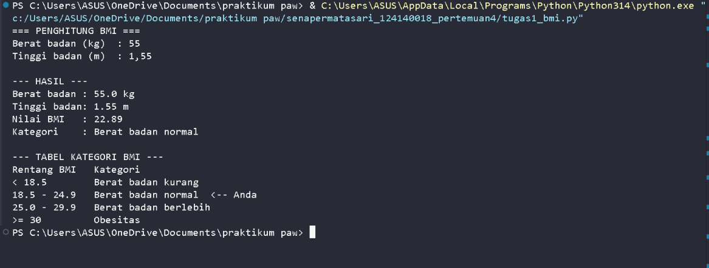
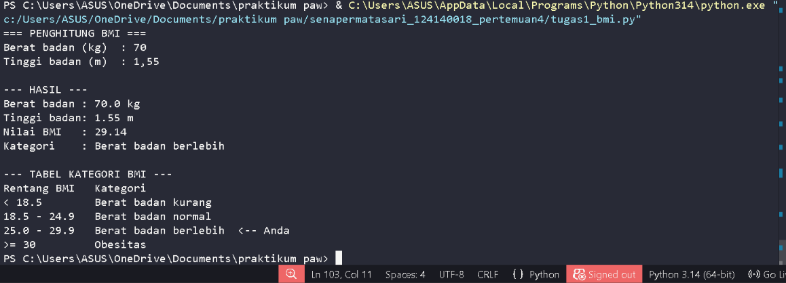
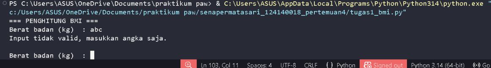
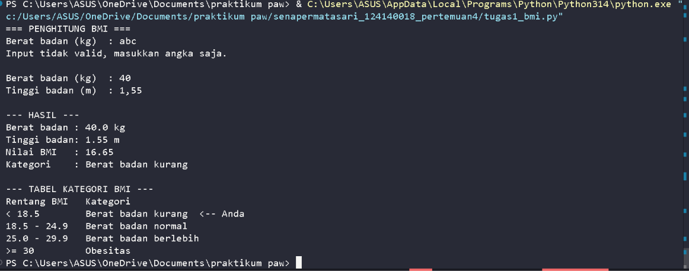
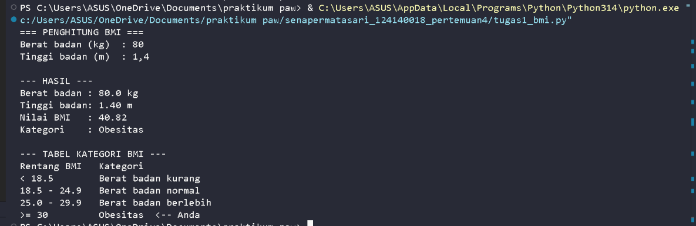
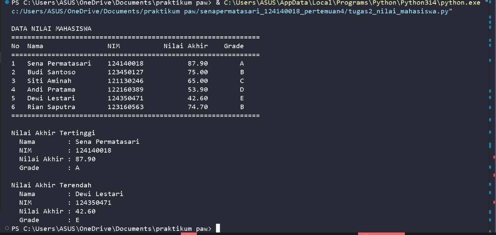
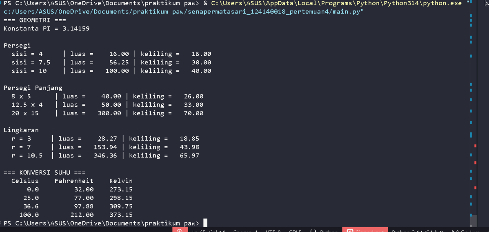
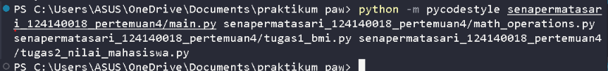
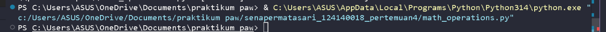

# Praktikum Pengembangan Aplikasi Web
## Pertemuan 4 – Python Dasar

**Nama:** Sena Permatasari  
**NIM:** 124140018  
**Program Studi:** Teknik Informatika  
**Institusi:** Institut Teknologi Sumatera (ITERA)

---

## Deskripsi Praktikum

Praktikum Pertemuan 4 membahas dasar-dasar pemrograman Python, mulai dari pengenalan sintaks, variabel, tipe data, struktur kendali, fungsi, hingga penggunaan modul dan package. Pada praktikum ini juga dilakukan penerapan materi melalui beberapa program sederhana.

## Tujuan Praktikum

1. Memahami dasar-dasar pemrograman Python.
2. Mengenal penggunaan variabel dan tipe data.
3. Memahami struktur kendali dalam Python.
4. Membuat dan menggunakan fungsi.
5. Memahami modularitas melalui penggunaan modul dan package.
6. Menerapkan materi Python melalui latihan dan tugas.

## Struktur Folder

```text
senapermatasari_124140018_pertemuan4/
│
├── latihan_mandiri/
│   ├── latihan_mandiri_1.py
│   ├── latihan_mandiri_2.py
│   ├── latihan_mandiri_3.py
│   ├── latihan_mandiri_4.py
│   ├── latihan_mandiri_5.py
│   ├── latihan_mandiri_6.py
│   └── password_gen.py
│
├── modul/
│   ├── 01_pengenalan_eksekusi_python.py
│   ├── 02_variabel_tipe_data.py
│   ├── 03_struktur_kendali.py
│   ├── 04_modularitas_fungsi.py
│   ├── 05_struktur_data.py
│   ├── 06_modul_package_python.py
│   └── kalkulator_lib.py
│
├── Screenshot/
│   ├── 01-tugas1-bmi-normal.png
│   ├── 02-tugas1-bmi-berlebih.png
│   ├── 03-tugas1-bmi-validasi-input.png
│   ├── 04-tugas1-bmi-kurang.png
│   ├── 05-tugas2-bmi-obesitas.png
│   ├── 06-tugas2-tabel-nilai-mahasiswa.png
│   ├── 07-tugas3-main.png
│   ├── 08-cek-pep8-pycodestyle.png
│   └── 09-tugas3-uji-modul-langsung.png
│
├── .gitignore
├── main.py
├── math_operations.py
├── tugas1_bmi.py
├── tugas2_nilai_mahasiswa.py
└── README.md
```

## Daftar Program

| File | Keterangan |
|---|---|
| `main.py` | Program utama untuk menjalankan operasi dari modul |
| `math_operations.py` | Modul berisi fungsi operasi matematika |
| `tugas1_bmi.py` | Program perhitungan dan kategori BMI |
| `tugas2_nilai_mahasiswa.py` | Program pengolahan nilai mahasiswa |
| `latihan_mandiri/` | Kumpulan latihan mandiri Python |
| `modul/` | Kumpulan materi dan latihan setiap modul |

## Cara Menjalankan Program

Pastikan Python sudah terpasang pada perangkat. Buka terminal di folder praktikum, kemudian jalankan program menggunakan perintah berikut:

```bash
python tugas1_bmi.py
```

Untuk menjalankan program pengolahan nilai mahasiswa:

```bash
python tugas2_nilai_mahasiswa.py
```

Untuk menjalankan program utama:

```bash
python main.py
```

## Dokumentasi Hasil Praktikum

### 1. Pengujian Program BMI dengan Kategori Normal

Menampilkan hasil perhitungan BMI ketika nilai indeks massa tubuh berada dalam kategori normal.



### 2. Pengujian Program BMI dengan Kategori Berat Berlebih

Menampilkan hasil perhitungan BMI ketika indeks massa tubuh termasuk kategori berat berlebih.



### 3. Pengujian Validasi Input pada Program BMI

Menampilkan proses validasi ketika pengguna memasukkan data yang tidak sesuai dengan ketentuan program.



### 4. Pengujian Program BMI dengan Kategori Berat Badan Kurang

Menampilkan hasil perhitungan BMI ketika indeks massa tubuh berada dalam kategori berat badan kurang.



### 5. Pengujian Program BMI dengan Kategori Obesitas

Menampilkan hasil perhitungan BMI ketika indeks massa tubuh termasuk kategori obesitas.



### 6. Hasil Pengolahan Data dan Tabel Nilai Mahasiswa

Menampilkan hasil pengolahan data nilai mahasiswa dalam bentuk tabel.



### 7. Implementasi Modul pada Program Utama

Menampilkan proses pemanggilan dan penggunaan fungsi dari modul `math_operations.py` melalui file `main.py`.



### 8. Pemeriksaan Kode Menggunakan Pycodestyle

Menampilkan hasil pemeriksaan kode Python menggunakan Pycodestyle untuk memastikan penulisan kode sesuai dengan standar PEP 8.



### 9. Pengujian Modul Secara Langsung

Menampilkan pengujian fungsi pada modul `math_operations.py` secara langsung untuk memastikan fungsi dapat dijalankan.



---

## Kesimpulan

Melalui praktikum ini, diperoleh pemahaman mengenai dasar-dasar pemrograman Python, penggunaan variabel dan tipe data, struktur kendali, fungsi, serta modularitas program. Materi tersebut diterapkan melalui pembuatan program BMI, pengolahan nilai mahasiswa, dan penggunaan modul. Selain itu, dilakukan pemeriksaan kode menggunakan Pycodestyle untuk memastikan penulisan kode mengikuti standar PEP 8.
