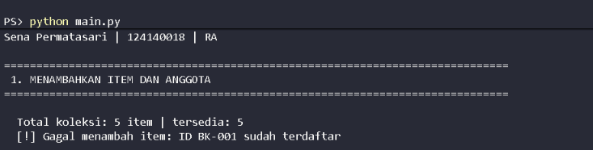
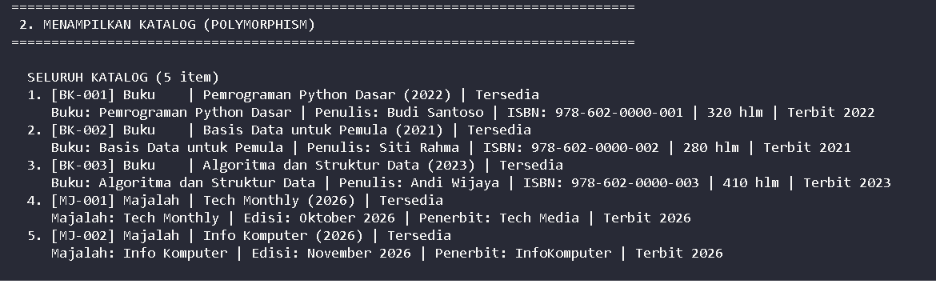
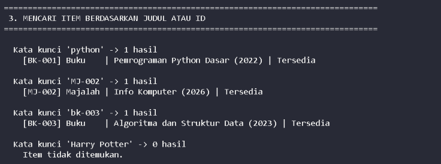
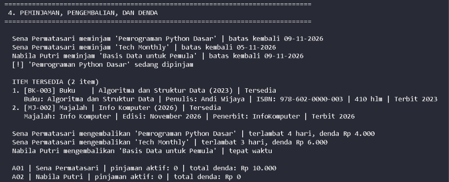
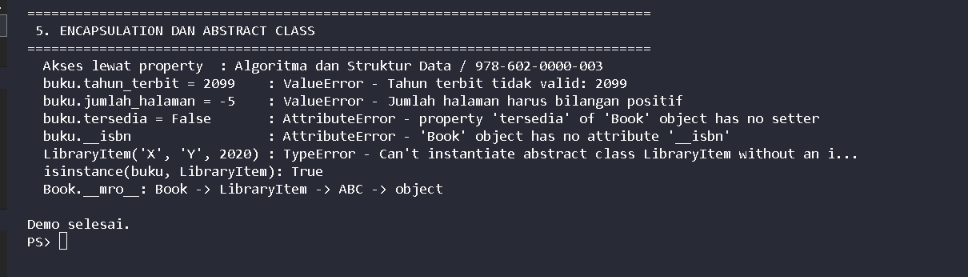
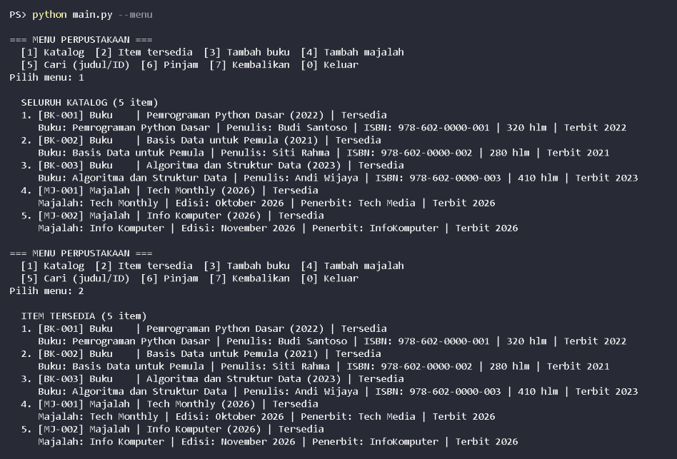
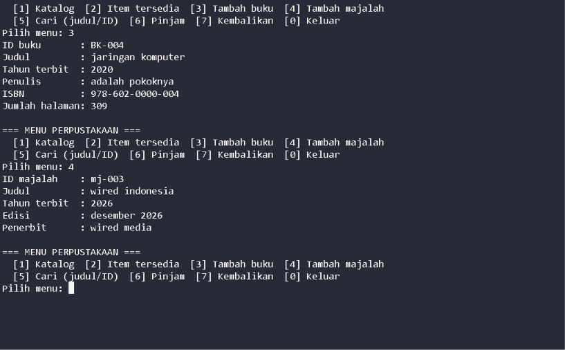
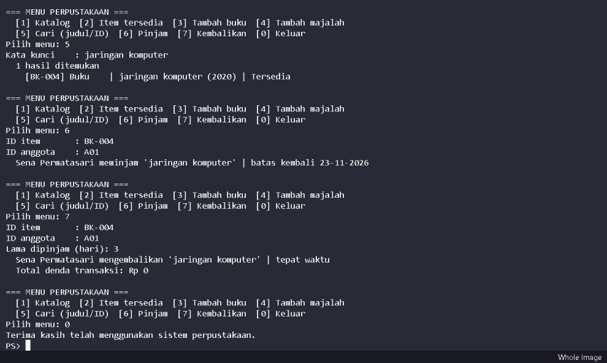

# Pertemuan 5 - Python OOP

Repositori ini berisi kode hands-on, latihan mandiri, dan tugas Pertemuan 5
(Pemrograman Berorientasi Objek dengan Python) mata kuliah Praktikum Pengembangan Aplikasi Web.

## Identitas Mahasiswa

| | |
|---|---|
| **Nama Lengkap** | Sena Permatasari |
| **NIM** | 124140018 |
| **Kelas Praktikum** | RA |

## Struktur Folder

```
senapermatasari_124140018_pertemuan5/
├── latihan/                    # Kode Hands-on 1-7 dari modul
│   ├── 01_everything_is_object.py
│   ├── 01_procedural_vs_oop.py
│   ├── 02_class_object.py
│   ├── 03_inheritance.py
│   ├── 04_encapsulation.py
│   ├── 05_polymorphism.py
│   └── 06_abstract_class.py
├── latihan_mandiri/            # Jawaban Latihan Mandiri
│   ├── lat1_toko_online.py
│   ├── lat2_kartu_buku.py
│   ├── lat3_armada_truk.py
│   ├── lat4_gaji_karyawan.py
│   ├── lat5_siaran_notifikasi.py
│   └── lat6_layanan_penyimpanan.py
├── tugas_perpustakaan/         # Tugas: Sistem Manajemen Perpustakaan
│   ├── library_item.py
│   ├── member.py
│   ├── library.py
│   └── main.py
├── ss/                         # Screenshot output
├── .gitignore
└── README.md
```

## Tugas: Sistem Manajemen Perpustakaan Sederhana

### Deskripsi Program

Program mengelola koleksi perpustakaan yang terdiri dari buku dan majalah.
Item ditambahkan ke `Library`, ditampilkan sebagai katalog, dicari berdasarkan
judul atau ID, lalu dipinjam dan dikembalikan oleh anggota (`Member`).
Denda keterlambatan dihitung otomatis dari selisih tanggal peminjaman.

**Alur program:** siapkan perpustakaan dan anggota -> tambah item -> tampilkan
katalog -> cari item -> pinjam dan kembalikan (hitung denda) -> uji encapsulation
dan abstract class.

### Daftar File

| File | Isi |
|---|---|
| `library_item.py` | Abstract class `LibraryItem`, subclass `Book` dan `Magazine`, fungsi `format_rupiah` |
| `member.py` | Class `Member` (anggota, daftar pinjaman, total denda) |
| `library.py` | Class `Library` (koleksi, anggota, pencarian, pinjam, kembali) |
| `main.py` | Program utama: demo otomatis dan menu interaktif |

### Penerapan 4 Pilar OOP

| Pilar | Penerapan |
|---|---|
| **Class dan Object** | `LibraryItem`, `Book`, `Magazine`, `Library`, `Member`. Objek dibuat di `main.py` lewat constructor `__init__` |
| **Inheritance** | `Book` dan `Magazine` mewarisi `LibraryItem` dan memanggil `super().__init__()` |
| **Encapsulation** | Atribut private: `__tersedia`, `__isbn`, `__koleksi`, `__anggota`, `__pinjaman`, `__total_denda`. `@property` dengan setter validasi pada `judul`, `tahun_terbit`, dan `jumlah_halaman`. `tersedia` dan `isbn` read-only |
| **Polymorphism** | `get_detail()`, `hitung_denda()`, `jenis`, dan `masa_pinjam` di-override berbeda oleh `Book` dan `Magazine`, lalu dipanggil dengan cara yang sama oleh `Library` |
| **Abstract Class** | `LibraryItem(ABC)` memiliki 4 abstract member sehingga tidak bisa diinstansiasi langsung |

### Fitur

- Menambah item dan menolak ID ganda
- Menampilkan seluruh katalog atau hanya item yang tersedia
- Mencari item berdasarkan judul atau ID (tidak peka huruf besar/kecil)
- Peminjaman dan pengembalian dengan batas 3 pinjaman per anggota
- Denda otomatis: buku Rp 1.000/hari (masa pinjam 7 hari), majalah Rp 2.000/hari (masa pinjam 3 hari)
- Mode menu interaktif (fitur tambahan)

### Cara Menjalankan

Persyaratan: Python 3.10 atau lebih baru.

```
cd tugas_perpustakaan
python main.py            # demo otomatis seluruh fitur
python main.py --menu     # menu interaktif
```

### Screenshot Output

#### Demo otomatis (`python main.py`)

**Menambah item**



**Menampilkan katalog**



**Mencari item berdasarkan judul atau ID**



**Peminjaman, pengembalian, dan denda**



**Encapsulation dan abstract class**



#### Menu interaktif (`python main.py --menu`)

**Katalog dan item tersedia**



**Tambah buku dan majalah**



**Cari, pinjam, dan kembalikan**



## Latihan (Hands-on Modul)

Dijalankan dari folder `latihan/`, misalnya `python 03_inheritance.py`.

| File | Topik |
|---|---|
| `01_everything_is_object.py` | Semua tipe data adalah objek |
| `01_procedural_vs_oop.py` | Perbandingan prosedural dan OOP |
| `02_class_object.py` | Class, object, atribut class vs instance, `__str__` dan `__repr__` |
| `03_inheritance.py` | Inheritance, `super()`, overriding, multiple inheritance, MRO |
| `04_encapsulation.py` | Public, protected, private, `@property`, name mangling |
| `05_polymorphism.py` | Polymorphism, duck typing, operator overloading |
| `06_abstract_class.py` | Abstract class dan interface |

## Latihan Mandiri

Dijalankan dari folder repo, misalnya `python latihan_mandiri/lat1_toko_online.py`.

| File | Soal |
|---|---|
| `lat1_toko_online.py` | Pemodelan entitas toko online (Produk, Keranjang, Pengguna) |
| `lat2_kartu_buku.py` | Class `Buku` dengan diskon dan `__len__` |
| `lat3_armada_truk.py` | Subclass `Truk` dengan validasi muatan |
| `lat4_gaji_karyawan.py` | Enkapsulasi gaji pokok dengan batas UMR |
| `lat5_siaran_notifikasi.py` | Siaran notifikasi multi-saluran (polymorphism) |
| `lat6_layanan_penyimpanan.py` | Interface `FileStorage` dengan abstract class |